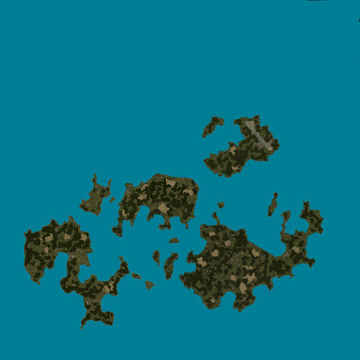

# Dayz Terrain Map

This is a tool to combine terrain textures from DayZ into a single map image.



## Just The Maps Please

Maps are periodically built and uploaded to https://maps.dzhosts.com/ and you are free to download them from there.

If the map you want is not available, you can use this tool to generate your own, or open a ticket and ask for it to be included.

## Using

```
Usage of dayz-terrain-map:
  -height int
        How many tiles high (default 32)
  -output string
        Output file name (default "map.png")
  -overlap int
        Overlap size (default 64)
  -size int
        Size of tiles (default 512)
  -source string
        Source directory containing PAA/PNG files (default "./layers")
  -width int
        How many tiles wide (default 32)
```

Run against a map directory containing terrain textures (PAA or PNG) inside a `./layers` folder (by default)

You may need to adjust the `-width`, `-height`, `-size`, and `-overlap` parameters based on your terrain.
